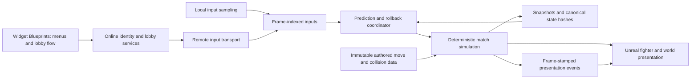

# Sonic Smackdown modernization plan

Updated: 2026-11-09. Status: baseline audit/ownership complete and UE5.8 migration validated for bounded Win64 scope;
historical gameplay parity and the broader behavioral specification remain open; simulation/online stages remain planned.

Read [AUDIT.md](AUDIT.md) for findings and [PROGRESS.md](PROGRESS.md) for current status. Detailed migration,
authoring, and gameplay evidence is in [MIGRATION.md](MIGRATION.md), [AUTHORING.md](AUTHORING.md), and
[GAMEPLAY_VALIDATION.md](GAMEPLAY_VALIDATION.md).

The completed source follow-up covers the SonicSmackdown project/module rename and PawnRenderLayers/CharacterSilhouette ports
from Origin of Storms; execution and validation are tracked in [PROJECT_IDENTITY_AND_RENDERING.md](PROJECT_IDENTITY_AND_RENDERING.md).
The follow-up also renames remaining OOS/OoS native files and code identifiers to SSD, with exact serialized type redirects.
The SSD Editor build and independent source review passed. The subsequently reported AssetTools startup crash is
fixed, and the requested notify-parent repair saved 13 packages with all 25 candidate Blueprints passing a fresh reload
and compilation. Final production Editor build and normal-RHI/audio startup also passed. See [SSD_BLUEPRINT_PARENT_REPAIR.md](SSD_BLUEPRINT_PARENT_REPAIR.md) and
[EDITOR_CRASH_2026_11_09.md](EDITOR_CRASH_2026_11_09.md). Broader gameplay/rendering tests remain deferred until old effects are removed.
Layer ordering, projection flattening and outline settings remain presentation state. Later rollback work must reconcile
their visible results without using synthetic render depth as gameplay position or collision state.

## Goal and scope

Upgrade the existing game from Unreal Engine 4.27 to 5.8, make match simulation deterministic, support rollback,
and deliver lobbies through which two players can connect and finish online matches. Resolve physics inconsistencies
against explicit gameplay rules while preserving the intended feel of the game.

The user authorized and then explicitly reconfirmed steps 1 and 2 after the audit: establish the legacy baseline/Blueprint
ownership map and migrate to UE5.8. This refers to the ordered implementation plan, not completion of deterministic physics.
Implementation now resides at `F:/UE4 Work/SonicSmackdown_R`; the old managed C: path is a compatibility junction.
The original `F:/UE4 Work/Sonic_Smackdown` checkout is preserved. See [RELOCATION.md](RELOCATION.md).
Determinism, rollback, physics behavior fixes, and online features remain subsequent work.

Current evidence: the supplied UE4 package is identified and the bounded Blueprint ownership inventory is complete;
historical gameplay parity is unobserved. Final helper-free UE5.8.4 Editor/Development/Shipping builds, 597 Blueprint
compilations (11 nonfatal warnings), five shader-layer variants, four MoveNetwork toolkit checks, and the repaired
FrameData toolkit check pass. Development cooking/package succeeds for 10,515 packages and the exact 19 configured maps.
Two packaged Development Sonic-versus-Shadow runs each pass 44 checks with prepared character/stage materials visible;
the final Shipping archive succeeds with the revised FXAA configuration and passes a separate 45-second startup-only
observation. Temporary helpers and owned capture/save fixtures were removed after review. This validates the bounded
Win64 migration, not a full Shipping match, full-roster coverage, or legacy parity. FrameData's inherited unfinished
animated preview remains a documented limitation.

The latest project instructions require MCP/headless Python for Unreal editing/testing and prohibit PC control.
Migration validation uses headless launchers, engine automation, and build tools; the old shipping package has no
verified editor Python interface. Do not turn this access limitation into a claimed baseline gameplay pass.

Initial planning assumptions are Win64, two active fighters, and a 60 Hz match simulation. They are proposals,
not confirmed platform or product requirements. Ranked matchmaking, spectators, tournament rooms, cross-play,
reconnect into an ongoing match, and dedicated match servers need separate scope decisions.

## Recommended order

1. Identify the UE4.27.2 reference and record gameplay/physics evidence where observable; inventory Blueprint ownership.
   The package identification and bounded inventory are complete; representative legacy gameplay remains unobserved.
2. Validate the UE5.8.4 migration using integrated plugin ports, cooked content, a packaged local match, and prepared-material visuals.
   This is complete for the bounded Win64 scope; uncovered roster, controller/menu, and legacy-parity cases remain recorded.
3. Build a small deterministic simulation covering two instances of one representative fighter and one stage.
4. Prove snapshot restoration and forced rollback locally on that slice.
5. Expand the simulation to the full roster and resolve physics/input defects with explicit expected outcomes.
6. Establish two-process rollback matches, first locally and then over a real connection.
7. Add identity, lobby discovery/invites, ready-up, match startup, results, rematches, and failure recovery.
8. Validate the entire release matrix and packaged builds.

Independent build, content, authoring, documentation, and gameplay checks can run in parallel when their file ownership
and process/memory requirements do not conflict. Simulation implementation remains later work. Test rollback on the
small slice before converting thousands of assets; expand roster coverage and transport in parallel once that proof
is sound. Online completion still requires every supported character to use the deterministic authoritative path.

The migration should preserve rendering and gameplay behavior before introducing new engine features. Epic supports
opening 4.27 projects in newer releases, recommends conversion on a copy, and documents physics changes from PhysX
to Chaos. There is no reason to schedule every intervening UE version without a specific blocker.
See [Epic's migration guide](https://dev.epicgames.com/documentation/en-us/unreal-engine/unreal-engine-5-migration-guide).

## Intended architecture

### Simulation owns match results

Use one authoritative match state and one explicit `StepFrame(inputs)` operation. Individual actor/component ticks,
animation updates, overlap callbacks, wall clocks, and engine timers must not independently advance combat.
The same initial state, content, rules, and input sequence must produce identical state on every supported build.

Keep Unreal responsible for rendering, sound, camera, authoring, menus, and platform integration. Match state uses
plain, explicitly serialized data with stable entity/content IDs. Unreal actors are views of that state, not the
only storage for it. Float conversion occurs at the presentation boundary.

A proposed frame order is: latch inputs; update command recognition and eligible timers; advance move timelines;
apply movement; resolve stage and fighter push collision; gather hit/throw/projectile contacts; resolve combat;
apply queued spawns/despawns; finish the round-state update; emit events and snapshot/hash state. Finalize exact
trade, throw-priority, spawn-frame, hitstop, and simultaneous-KO rules before making this order the specification.

Use a fixed simulation rate independent of render rate. Specify catch-up and overload behavior without dropping
authoritative frames or changing the timestep. Local pacing and network frame advantage belong in the coordinator.
An engine fixed-framerate setting or physics substepping is not a substitute for this match clock.

### Fixed-point contract

No fixed-point implementation was found in the inspected gameplay code. This work introduces one rather than
merely making an existing library deterministic.

- Measure stage extents, maximum speed/acceleration, collision sizes, and cumulative values before choosing units,
  integer width, and fractional precision. Do not commit to a particular Q format before range analysis.
- Specify rounding for positive and negative values, division, multiplication, casts, overflow, and zero divisors.
  Use defined-width operations and sufficiently wide intermediates; avoid signed overflow and platform-dependent shifts.
- Use integer frame counters for all match durations, with a documented rule for converting authored seconds.
  Distinguish timers paused by hitstop, super freeze, round transitions, and training pause.
- Quantize authoring data once into immutable match data. Store a content/rules hash and version with replays and sessions.
- Use deterministic collision math, stable traversal/contact order, and explicit tie-breaking. Prefer squared-distance
  comparisons where practical; define any required square-root or trigonometric behavior explicitly.
- Give gameplay randomness an explicit algorithm, seed, and snapshotted state. Cosmetic randomness cannot alter simulation.

This scope includes every match-affecting operation, including inputs, AI where supported, rings, throws, root motion,
timers, and spawn order. Rendering, particles, audio, and camera math can remain floating point.

### Movement, collision, and authoring

Build deterministic stage bounds, fighter push resolution, hit/hurt volumes, projectile collisions, throws, and ring
movement/collection. Establish whether current stages require geometry beyond a flat fighting plane and walls during
the Blueprint/content audit. Treat free-moving props as presentation unless they explicitly affect the match.

Preserve current move-graph authoring where useful. The existing FrameData module is unfinished and needs implementation
or replacement, not merely enabling. Convert gameplay animation notifies into frame-indexed move events. Bake or author
root-motion deltas and combat-relevant socket/shape tracks; evaluate them from simulation frames, including mirroring
and move playback rates. Animation may display combat state but may not decide when damage or movement occurs.

Designer-facing data stays editable. All new UI hookup, event binding, navigation, and lobby flow orchestration stays
inside Widget Blueprints, per the project instruction. Simulation/online services may expose gameplay operations and
events, but C++ must not wire widgets together.

The completed [Blueprint inventory](BLUEPRINTS.md) makes the main ownership boundary concrete: the HUD currently
advances a float match timer and writes round/winner state; cinematic graphs change speeds/locations; RapidPunch uses
a world timer and global random float values to spawn gameplay projectiles. Preserve designer-owned UI wiring while
giving these match-affecting operations an explicit simulation contract in the later conversion.

### Snapshot and rollback contract

Snapshot all state that can change future match outcomes:

| State group | Required contents |
| --- | --- |
| Match | Frame, phase, round time/results, rules/content version, stage state, RNG and entity allocator state |
| Fighters | Stable identity, active normal/transformed form, position/velocity, facing, grounded/flight/push state |
| Combat | Health/resources/rings, combo scaling/counters, armor, invulnerability, cancel/tech state, move and state frames |
| Time | Remaining hitstop, hitstun, blockstun, freeze, lockout, flight, projectile and ring lifetimes |
| Inputs | Held/previous input, motion recognition state, charge counters, buffered commands and expiry frames |
| Entities | Hit/hurt shapes, projectiles, rings/helpers, owners, hit records, spawn/despawn queues and pending events |

Keep immutable content outside snapshots and reference it by stable ID. Define canonical field order, widths, byte
order, and schema version. Do not hash raw struct padding, pointers, UObject addresses, or incidental container order.

Save before each frame. Predict missing remote held input using an explicit policy; derive press/release edges from
the frame stream. When confirmed input differs, restore the state before the earliest incorrect frame and replay
through the current frame. A restored match must reproduce the uninterrupted result exactly.

Bound history and prediction. If input arrives outside the supported window, use a documented stall/disconnect policy;
do not silently discard it or claim that visibly different peers have recovered. Agree on history depth/input delay
using measured CPU/memory and latency targets.

Give visual/audio events stable keys such as frame, entity, event type, and sequence number. During replay, reconcile
or suppress duplicates. Separate predicted, reversible effects from confirmed outcomes such as persistent results.
Rollback must not spawn duplicate sounds, projectiles, rewards, or menu transitions.

Evaluate GGPO as an integration candidate after the simulation API works. Its API explicitly requires game-provided
state save/load and frame advancement; it cannot supply the missing deterministic combat model.
See [GGPO callbacks](https://github.com/pond3r/ggpo/blob/master/src/include/ggponet.h).

### Online matches and lobbies

Treat rollback transport and lobby services as separate layers. Start with two-player peer simulation exchanging
frame-indexed inputs, acknowledgments and recent redundant history. Validate sender/slot, frame ranges, message sizes,
session identity, and protocol versions. Handle duplication, loss, reordering, jitter, disconnects, and frame advantage.

Before frame zero, both peers must agree on build/protocol, deterministic content/rules hashes, characters/forms,
stage, RNG seed, player slots, input-delay policy, and match identity. Both must finish loading before starting.
Detect desyncs with canonical frame hashes and retain useful input/state diagnostics.

Choose the backend after platform/storefront requirements are known. EOS is a candidate for identity/lobbies and P2P
integration; a Steam-specific service is an alternative if distribution is Steam-only. No provider is selected and
no account setup, SDK installation, or service provisioning is part of this audit. Verify UE5.8 support and the chosen
transport's NAT/relay behavior in the integration spike. Epic's [online services sample](https://github.com/EpicGames/EOS-Getting-Started)
is a starting reference, not proof that this game's integration already works.

Minimum lobby flow: sign in -> create/find/join or invite -> select fighters/stage -> ready -> synchronize/load ->
play -> result -> rematch or return to lobby. Handle cancellation, full/stale rooms, failed connections, mismatched
versions, and a departing host/peer. Put all user-facing wiring and navigation in widgets.

## Milestones and completion gates

| ID | Deliverable | Completion evidence |
| --- | --- | --- |
| M0 | Baseline and behavioral specification | UE4.27.2 build/package or clearly identified existing baseline; Blueprint ownership inventory; representative recordings and expected physics cases |
| M1 | Bounded UE5.8 Win64 compatibility migration | Builds/configured-map cook pass; representative toolkit initialization passes with limits documented; packaged sample match/material checks, final Shipping archive and startup observation pass |
| M2 | Deterministic simulation slice | Two instances of one fighter and one stage; repeatable input playback; canonical frame hashes agree across runs/render schedules |
| M3 | Local rollback slice | Forced restores/replays match uninterrupted hashes at every compared frame; no duplicate presentation side effects |
| M4 | Complete gameplay conversion | Roster, forms, moves, stages, rings, throws and projectiles migrated; confirmed physics issues resolved and reviewed |
| M5 | Network rollback | Two packaged processes stay synchronized under the accepted network matrix; startup/version checks and desync/disconnect handling pass |
| M6 | Online lobby flow | Two users can join, ready, complete a match, rematch, and leave; failure paths work; UI connections remain in widgets |
| M7 | Release validation | Supported machine/build/platform matrix passes; performance budget, content coverage and outstanding issues are documented |

M0's reference identification and bounded ownership inventory supplied the migration baseline. M1 is now validated for
the documented Win64 scope, while M0's historical gameplay comparison/full behavioral specification remains open.
Resolve the behavior rules needed by the deterministic slice before M2/M3; these stages are not implemented by the migration.
M4 and transport prototyping can proceed after M3; M5 completion requires M4 coverage. M6 needs stable match startup/teardown
from M5. M7 requires the full release matrix. These are evidence gates, not calendar estimates.

## Validation strategy

For determinism, compare canonical hashes of every simulation frame, not screenshots or final health alone. Run repeated
long input recordings, snapshot/restore at multiple frames, and forced rollback at depths including 1, 2, 4, and 8 frames
plus the final supported limit. Report the first divergent field and frame. A passing test only establishes coverage
for the exercised paths and configurations; track roster/move coverage explicitly.

Vary render schedules (30/60/120/144 FPS, uncapped, and induced hitches), process runs, compiler/build configurations,
and each supported CPU/platform. The simulation should consume the same frame inputs and produce the same hashes.
Test identical characters on both sides, swapped player slots, simultaneous hits/throws, corner pressure, cross-ups,
projectile clashes and multihits, ring bounces/collection, transformations, supers, freezes, and round transitions.

Proposed initial network probes: 0/50/100/150 ms round-trip latency, 0/10/30 ms jitter, 0/1/3 percent loss, packet
duplication/reordering, brief outages, and sustained disconnects. These are test points, not a promised playable envelope.
Choose shipping tolerances from results and playtesting. Measure worst-case full rollback cost and memory with the most
demanding supported match; establish a budget within the target frame interval on minimum hardware.

For the engine upgrade, compile, exercise custom editor tools, compile Blueprints, compare reference visuals, and cook/package.
Include all intended shipping content without blindly bulk-resaving 64,039 packages before plugin compatibility is solved.
Track changed assets and migration warnings explicitly.

Keep replay/desync diagnostics as an intentional feature when implemented. Remove temporary test scripts, test files,
fixtures, captures, and scratch outputs after each completed feature as requested; record outcomes and reproduction
recipes in these documents. Migration validation has used temporary helpers; retain required in-progress evidence
until its outcome is recorded, and track removal in the corresponding validation document.

## Decisions and risks to resolve

| Topic | Current proposal or open decision |
| --- | --- |
| Engine patch | Use installed UE5.8.4 for the initial migration and pin the exact patch/build |
| Existing shader port | AFHeroes port integrated; five DX11 layer variants and visible Sonic/Shadow package materials pass; four inherited material failures remain |
| Legacy baseline | User-supplied July 2024 package identified; predates August source revision; gameplay parity unobserved and PC control prohibited |
| Platforms/storefronts | Win64 first is provisional; confirm Steam/EOS/cross-play expectations before backend selection |
| Physics intent | Capture known player-reported issues and decide deliberate quirks versus defects |
| Numeric format | Choose after content bounds/range analysis, including multiplication intermediates |
| Blueprint authority | Core ownership confirmed in 57 assets; remaining roster/defaults/notifies still need coverage before full simulation conversion |
| Local controllers | Unchanged ID 0-7 creation loop reaches UE5.8's four-player limit; hardware/menu/rematch coverage and intended slot policy remain open |
| Authoring/content limits | Toolkit initialization passes; FrameData animated preview is inherited unfinished work; full graph edit/save workflows and warning effects remain unverified |
| Online scope | Confirm public/private rooms, invites, room size, spectators, ranked play, and reconnect expectations |
| Performance | Select minimum hardware and acceptable rollback/input-delay envelope before promising limits |

The shading donor is `F:/UE4 Work/AFHeroes/Plugins/PrExtendedShadingPro`; AUDIT.md records version, log evidence,
alternate copies, and an existing donor project-file edit that is preserved. The port is integrated in the migration
checkout, and its five DX11 material-layer variants passed. Cook/package and the visible sampled materials also pass;
historical visual comparison and full material-library correctness remain separate from those results.

The largest remaining effort is extracting complete gameplay authority from actor/animation/Blueprint behavior and
converting content consistently. A working shader port reduces migration risk but does not resolve determinism or rollback.
Estimate implementation only after M0/M1 and the simulation slice expose the real content and integration costs.

## Active follow-up: Blueprint audit and gameplay regressions

The user authorized a full remaining-Blueprint rename audit and targeted repairs for Training gamepad control after character selection
and Rouge's repeated facing snap after attacks/jumps. This work is in progress; see [BLUEPRINT_HANDOFF_AND_FACING.md](BLUEPRINT_HANDOFF_AND_FACING.md).
Earlier deferral of broad effects/rendering tests does not defer these requested checks. Editor-only scope and preservation of user edits still apply.

## Stopped at user request — 2026-11-09

Blueprint audit completed and Training gamepad routing was fixed/validated. Rouge's recovery-pose snap was reproduced; the candidate animation fix compiles but has not been runtime-validated. Temporary helpers remain. Work stopped at the user's explicit request; see the checkpoint in [BLUEPRINT_HANDOFF_AND_FACING.md](BLUEPRINT_HANDOFF_AND_FACING.md) before resuming.
